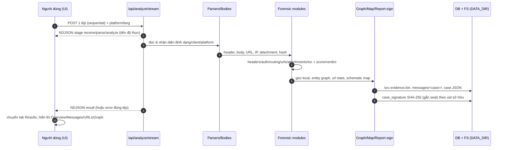

# Hướng dẫn cài đặt & vận hành — MailSleuth Python

Tài liệu này mô tả cách triển khai, cấu hình, sử dụng và hiểu kiến trúc/luồng dữ liệu của bản **FastAPI** trong `mailsleuth_python/` (song song với bản Node gốc, dữ liệu tách biệt qua `DATA_DIR`).

---

## 1. Yêu cầu & cài đặt

### 1.1 Yêu cầu
- **Python** 3.10+ (khuyến nghị 3.12). `pip` ≥ 23.
- **Node.js** (tùy chọn, chỉ để kiểm tra cú pháp frontend `node --check public/app.js`).
- **GeoLite2** (`.mmdb`) trong `GEOIP_DIR` để tra vị trí IP nội bộ (không gọi dịch vụ ngoài).
- **Trình duyệt** hiện đại (Chromium/Edge/Firefox). Chức năng chọn vị trí lưu/mở thư mục dùng File System Access API khi có; nếu không sẽ fallback tải xuống/chọn tệp.

> `PST/OST` không được server phân tích trực tiếp. Hãy trích xuất sang `.eml/.mbox/Maildir` bằng `readpst` (libpst), Outlook hoặc công cụ tương đương, sau đó nạp kết quả vào hệ thống.

### 1.2 Cài đặt
```powershell
cd "D:\Digital Forensics\mailsleuth_python"
python -m venv .venv
.venv\Scripts\Activate.ps1
pip install -r requirements.txt
copy .env.example .env
```
(Linux/macOS: `python3 -m venv .venv && source .venv/bin/activate`, `cp .env.example .env`.)

Sửa `.env` nếu cần (xem mục 3). Tạo thư mục dữ liệu sẽ được tự khởi tạo khi chạy lần đầu (`DATA_DIR`: `uploads/`, `evidence/`, `messages/`, `tmp/`, `reports/`, `app.db`).

### 1.3 Khởi tạo tài khoản quản trị (khuyến nghị)

Quản trị viên dùng cơ chế **khóa/verifier offline**: dẫn xuất bằng **PBKDF2-HMAC-SHA256 (600.000 vòng)** từ `password + SHA-256("mailsleuth-admin-v1|<username>|<CCCD số>")`. Chỉ lưu `salt` (băm từ CCCD), số vòng lặp và `verifier` của khóa dẫn xuất — **không lưu CCCD, không lưu mật khẩu**. Khóa khôi phục (`MSK1-...`) chỉ hiển thị/ghi ra file một lần.

```powershell
# Lần đầu / enroll (yêu cầu CCCD)
python tools/admin_keygen.py --user admin --cccd 001203004567 --write-db --key-out .\admin.key

# Đổi mật khẩu (dùng salt đã lưu, không cần nhập lại CCCD)
python tools/admin_keygen.py --user admin --password --write-db --key-out .\admin.key
```
- Chạy trên máy chủ, không chạy trên máy chia sẻ; bảo quản `admin.key` ngoại tuyến rồi xóa bản tạm.
- Đăng nhập admin bằng **mật khẩu**; khóa `MSK1-...` dùng như bí mật khôi phục/xác thực thay thế theo cơ chế đã lập.
- `ADMIN_PASS` trong `.env` chỉ là **bootstrap legacy/dev** khi chưa có admin; sau khi enroll bằng keygen nên gỡ/không dùng ở môi trường thật.

### 1.4 Chạy server
```powershell
python -m uvicorn app.main:app --host 127.0.0.1 --port 8000
```
Mở `http://127.0.0.1:8000`. (Chạy song song bản Node ở cổng khác nếu cần; `DATA_DIR` phải tách biệt.)

---

## 2. Sơ đồ kiến trúc hệ thống

```mermaid
flowchart TB
  subgraph Client["Trình duyệt - SPA (public/)"]
    UI[index.html + app.js + app.css + fx.js]
    UI --> T1[Analysis: chọn tệp/thư mục, nền tảng Win/Linux\nstream 3 dòng + biên độ + %\nPause/Stop/Cancel]
    UI --> T2[Results: Overview/Messages/URLs/Graph\nheader/body, export/import, verify]
    UI --> T3[Guide / History / DNS / IP-Geo / Local AI]
    UI --> T4[Administration / Logs (chỉ ADMIN)]
  end

  subgraph Server["FastAPI - app/main.py"]
    MW[Middleware: session cookie, CSRF, rate-limit, headers]
    API1[Auth/Profile: register/login/recover/rename\nRBAC + ownership theo cases.uid]
    API2[Analyze: /api/analyze/stream NDJSON\n/api/analyze batch]
    API3[Case/Report: cases, message, urls, graph, map\nreport html/pdf/csv/json, verify]
    API4[URL import/export, DNS/IP, Local AI settings\nAdmin users/stats/logs/sessions]
  end

  subgraph Modules["Mô-đun xử lý (app/)"]
    P[parsers.py, bodies.py\nEML/MSG/MBOX/Maildir/TXT\nnhận diện client & platform]
    F[headers.py, authcheck.py, routing.py\nurls.py, attachments.py, ioc.py]
    E[enrichment.py, dns_real.py\nGeoIP local, DNS (tùy LIVE_DNS)]
    U[urlintel.py\nparse CSV/JSON/XML/TXT\nrule local, merge, CSV-safe]
    G[graph.py\nthực thể/cạnh từ chứng cứ]
    M[mapgen.py\nbản đồ lược đồ nội bộ]
    R[report.py\nHTML/PDF/CSV, seal + case_signature SHA-256]
    L[llm.py\nLocal AI (localhost/private), redact]
  end

  subgraph Data["DATA_DIR"]
    DB[(app.db SQLite WAL)\nusers, cases, audit, kv\nsessions, session_signatures, url_imports]
    EV[evidence/<case>.bin (read-only)]
    MS[messages/<case>/*.hdr|txt|html|json]
    Q[quarantine/]
    UP[uploads/tmp/reports]
  end

  subgraph Local["Tài nguyên cục bộ (tùy chọn)"]
    GEO[(GeoLite2 *.mmdb)]
    DNSR[(DNS resolver khi LIVE_DNS=1)]
    LAI[(Ollama/LM Studio/vLLM\nlocalhost)]
  end

  Client <-->|cookie sid + x-csrf| Server
  API2 --> P --> F --> E
  F --> U --> R
  E --> G --> R
  E --> M
  L -. optional, local-only .-> F
  Server <--> Modules
  Modules <--> DB
  Modules <--> EV
  Modules <--> MS
  Modules <--> Q
  E --> GEO
  E -. optional .-> DNSR
  L -. optional .-> LAI
```

**Nguyên tắc:** offline-safe mặc định (không tile/bản đồ ngoài, không AI cloud). `LIVE_DNS=0` tắt truy vấn DNS thật; GeoIP đọc cơ sở dữ liệu cục bộ.

---

## 3. Luồng xử lý & luồng dữ liệu

### 3.1 Luồng phân tích (streaming)



- **Pause**: dừng sau tệp hiện tại; **Stop**: hủy phần còn lại nhưng giữ kết quả đã hoàn tất; **Cancel**: hủy và bỏ kết quả của lượt chạy.
- Mỗi tệp một request streaming → lỗi dừng đúng tệp và báo rõ, có thể xử lý rồi chạy tiếp tệp sau.

### 3.2 Luồng dữ liệu vụ việc (case → messages → entities → links)

```mermaid
flowchart TB
  Inv[Case/Vụ việc\nid, uid sở hữu bất biến, sig SHA-256, platform, lang] --> Msg[Messages\nindex, client/format, from/to/subject/date\nheaders, body ref, originIPs, auth, verdict]
  Msg --> Ent[Entities (trích từ chứng cứ)\nactor/address, domain, ip, url, attachment/hash]
  Ent --> Lnk[Links/Relations\nCONTAINS, SENT, TO/CC/BCC\nUSES_DOMAIN, ORIGIN_IP\nCONTAINS_URL, HAS_ATTACHMENT]
  Lnk --> Graph[Đồ thị /api/case/{id}/graph(.svg)\nchỉ từ chứng cứ, không suy diễn]
  Msg --> Store1[(cases.result JSON trong DB)]
  Msg --> Store2[(messages/<case>/idx.hdr|txt|html|json)]
  Inv --> Store3[(evidence/<case>.bin, read-only)]
```

- **Sở hữu** gắn với `users.uid` (hex32, bất biến). Đổi tên tài khoản không ghi đè `cases.user` và không làm mất quyền truy cập/lịch sử/chữ ký của vụ việc đã ký.

### 3.3 Luồng URL import & tái phân tích

```mermaid
flowchart LR
  A[Export URL CSV theo case] --> B[Phân tích ngoài (tùy chọn)]
  B --> C[Import CSV/JSON/XML/TXT]
  C --> D[Parse & chuẩn hóa entry]
  D --> E[Re-analyze bằng rule/mẫu local\n(offline, một lần)]
  E --> F[Merge theo URL: verdict/risk/reasons/source/target]
  F --> G[Cập nhật case + urlImports + tái ký SHA-256]
  G --> H[Verify/Report phản ánh kết quả mới]
```

### 3.4 Luồng báo cáo & xác minh chữ ký

```mermaid
flowchart LR
  R[case row + result JSON] --> S[case_signature: SHA-256 canonical facts]
  S --> H[HTML: seal SVG góc dưới phải + CSP chặt]
  S --> P[PDF: vẽ seal]
  S --> C[CSV/JSON theo ngôn ngữ]
  S --> V[/api/report/{id}/verify\nrecompute & compare]
```

Chữ ký là **fingerprint toàn vẹn** (deterministic) để kiểm tra dữ liệu vụ việc không bị thay đổi; không phải chữ ký số bằng khóa bí mật/PKI.

---

## 4. Cấu hình (.env)

| Biến | Mặc định | Mô tả |
|---|---:|---|
| `PORT` | 8000 | Cổng lắng nghe |
| `DATA_DIR` | ./data | Dữ liệu runtime (DB, evidence, messages, quarantine, uploads/tmp/reports) |
| `GEOIP_DIR` | ../mailsleuth/geoip | GeoLite2 (`GeoLite2-*.mmdb`) |
| `LIVE_DNS` | 0 | `1` bật tra DNS thật (SPF/DKIM/DMARC/PTR...); `0` offline-safe |
| `LIVE_DNS_DOMAINS` | 5 | Giới hạn domain tra DNS mỗi lần phân tích |
| `GEO_IPS` | 20 | Giới hạn IP tra GeoIP |
| `COOKIE_SECURE` | 0 | `1` khi chạy HTTPS (Secure cookie) |
| `TRUST_PROXY` | (rỗng) | `1` khi đứng sau reverse proxy tin cậy |
| `LLM_ENABLED` | 0 | Bật Local AI (mặc định tắt; cấu hình endpoint/model/key per-user trong UI) |
| `LLM_BASE_URL` | http://127.0.0.1:11434/v1 | Endpoint OpenAI-compatible cục bộ |
| `LLM_MODEL` | qwen2.5:7b | Mẫu gợi ý |
| `LLM_ALLOW_REMOTE` | 0 | `0` từ chối endpoint không phải loopback/private |
| `THREATSCAN_ENABLED` | 1 | Bật quét nội dung độc hại offline (heuristic + engine local nếu có) |
| `THREATSCAN_TIMEOUT` | 15 | Timeout (giây) cho engine/tool quét |
| `THREATSCAN_MAX_BYTES` | 26214400 | Giới hạn byte quét mỗi tệp đính kèm |
| `YARA_RULES_DIR` | ./rules/yara | Thư mục rule YARA cục bộ |
| `YARA_CLI` / `CLAMSCAN_CLI` | (rỗng) | Đường dẫn YARA/ClamAV tùy chọn (auto-detect nếu rỗng) |
| `SANDBOX_URL` | (rỗng) | Adapter sandbox cục bộ (chỉ localhost/private) |
| `BODY_MAX_BYTES` | 524288 | Giới hạn body mỗi thư (byte) |
| `BODY_TOTAL_BYTES` | 33554432 | Ngân sách body mỗi vụ việc |
| `AVATAR_RATE_MAX` | 20 | Giới hạn đổi avatar/IP/phút |
| `SIEM_*` | (rỗng) | Tùy chọn đẩy/xuất SIEM (Wazuh/Splunk/Elastic), để trống = tắt |

> Không đặt khóa/dịch vụ bản đồ ngoài; hệ thống dùng map lược đồ nội bộ. Không dùng AI cloud (bị chặn khi `LLM_ALLOW_REMOTE=0`).

---

## 5. Hướng dẫn sử dụng giao diện

1. **Đăng nhập/Đăng ký**: nhập username, SĐT hoặc user ID. User thường đăng ký có SĐT (tùy chọn), nhận **Key ID khôi phục (một lần)** — cần lưu lại để đặt lại mật khẩu. Có thể khôi phục bằng Key ID và đăng nhập bằng username/SĐT.
2. **Dashboard & nền tảng**: chọn thẻ **Windows** hoặc **Linux** để đặt ngữ cảnh; Auto-detect vẫn nhận từ tệp. Dashboard hiển thị thống kê vụ việc/thư/mức rủi ro.
3. **Phân tích (Analysis)**: kéo-thả hoặc chọn tệp/thư mục (`.eml/.msg/.mbox/.emlx/.mht/.mhtml/.txt`, Maildir). Preflight loại tệp không hợp lệ. Nhấn **Analyze** để chạy streaming: 3 dòng (tệp/giai đoạn/chi tiết) + thanh biên độ + %. **Pause** dừng sau tệp hiện tại, **Stop** giữ kết quả đã xong, **Cancel** hủy lượt chạy. Khi xong tự chuyển sang **Results**.
4. **Kết quả (Results)**: dải nhận diện client/nền tảng; sub-tab **Overview/Messages/URLs/Graph**. Mở từng thư để xem header/body (HTML đã khử nguy hiểm, sandbox). Xuất **Report HTML/PDF/CSV** (theo ngôn ngữ), **Verify signature**, export bundle/URL CSV; **Import URL** (CSV/JSON/XML/TXT, tệp hoặc thư mục) để tái phân tích local và gộp vào vụ việc.
5. **History/DNS/IP-Geo**: mở lại vụ việc; tra cứu DNS và IP/Geo (local), xem bản đồ lược đồ nội bộ.
6. **Local AI**: cấu hình endpoint/model local và kiểm tra kết nối (chỉ localhost/private). Bật/tắt theo tài khoản.
7. **Guide**: hướng dẫn, ghi chú, lưu ý vận hành.
8. **Administration/Logs (ADMIN)**: thống kê, tạo tài khoản (analyst/admin; admin cần enroll/verifier theo quy trình), cấp token đổi tên một lần, bật/tắt/quyền (có chặn tự khóa/tự hạ quyền), xem audit & phiên ký.

**Cảnh báo viền phát sáng:** đỏ = nguy hiểm, vàng = đáng nghi, xanh = chưa chắc chắn; trạng thái bình thường không phát sáng.

---

## 6. API tham chiếu (chính)

| Nhóm | Endpoint | Ghi chú |
|---|---|---|
| Auth | `POST /api/register`, `/api/login`, `/api/logout`, `/api/recover`, `/api/password` | CSRF cho request ghi; session cookie `sid` |
| Hồ sơ | `GET /api/me`, `GET/POST /api/profile*`, `POST /api/profile/rename` | Đổi tên cần token một lần do admin cấp |
| Phân tích | `POST /api/analyze/stream`, `POST /api/analyze` | Stream NDJSON từng tệp; batch nhiều tệp |
| Vụ việc | `GET /api/cases`, `GET /api/case/{id}/message/{idx}` | Theo quyền sở hữu uid (admin xem tất cả) |
| URL | `GET /api/case/{id}/urls(.csv)`, `POST /api/urls/import`, `GET /api/urlintel/{id}(.csv)` | Import parse + local re-analysis + merge + re-sign |
| Đồ thị/IOC | `GET /api/case/{id}/graph(.svg)`, `GET /api/ioc/{id}(.csv)`, `GET /api/export/{id}` | Đồ thị từ chứng cứ; export IOC/SIEM |
| Báo cáo | `GET /api/report/{id}` `(.pdf`, `.csv)`, `/api/report/{id}/verify` | `lang=en|vi`; ký SHA-256 + seal; CSP/no-store |
| Tra cứu | `POST /api/dns`, `POST /api/ip`, `GET /api/map` | DNS/Geo local; map lược đồ nội bộ |
| Cài đặt | `GET/POST /api/settings/llm`, `GET/POST /api/settings/map` | Local AI per-user; map luôn chế độ local |
| Quản trị | `GET/POST /api/admin/*` | users/stats/logs/sessions, tạo user, cấp rename token, role/disable/reset (chỉ admin) |

Mã lỗi API trả về dạng `{"error":"<code>"}` (ví dụ `auth`, `csrf`, `forbidden`, `rate`, `too_large`, `file_too_large`, `local_only`).

---

## 7. Lưu trữ & vệ sinh dữ liệu

- `evidence/<case>.bin`: bản gốc chỉ đọc (phục vụ tái dựng body/báo cáo).
- `messages/<case>/`: header/body đã trích (text + HTML đã khử nguy hiểm) theo chỉ số thư.
- `quarantine/`: bản sao cách ly của tệp đính kèm nguy hiểm (read-only).
- `uploads/tmp/reports`: vùng tạm/báo cáo; nên dọn định kỳ theo chính sách lưu trữ.

Công cụ hỗ trợ: `tools/purge.py` (xem/áp dụng xóa theo thời gian hoặc theo case, có log purge). Sao lưu `app.db` kèm `evidence/` và `messages/` nếu cần di chuyển.

---

## 8. Kiểm thử & xác minh

```powershell
# biên dịch/kiểm tra cú pháp
python -m py_compile app\main.py app\db.py app\auth.py app\report.py app\urlintel.py app\mapgen.py app\graph.py app\parsers.py app\llm.py app\bodies.py app\urls.py
node --check public\app.js

# bộ kiểm thử/audit trong repo
python tests\audit.py            # (tùy kịch bản/môi trường)
python tools\verify_model.py     # nếu dùng ML
```

Khuyến nghị kiểm thử thủ công trên UI: streaming + Pause/Stop/Cancel, tự chuyển Results, xem header/body, export (chọn vị trí), import URL, xác minh chữ ký, phân quyền admin/analyst, dark mode và i18n.

---

## 9. Bảo mật & lưu ý vận hành

- **Offline-safe mặc định**: không gọi bản đồ/AI ngoài; Local AI chỉ localhost/private; `LIVE_DNS=0` khi cần cô lập mạng.
- **Bí mật**: không lưu/không in CCCD; không echo key API; khóa admin/verifier tạo offline (`tools/admin_keygen.py`).
- **Phân quyền & chống leo thang**: RBAC (admin/analyst), sở hữu case theo `uid` bất biến, kiểm tra CSRF cho thao tác ghi, chặn tự hạ quyền/tự vô hiệu hóa.
- **Toàn vẹn & hiển thị an toàn**: chữ ký SHA-256 + con dấu; CSP `default-src 'none'`, `nosniff`, `no-referrer`, `no-store` cho báo cáo; HTML body được sanitize và render trong sandbox; CSV xuất được trung hòa công thức.
- **Bản đồ**: lược đồ nội bộ từ tọa độ GeoIP — mang tính hỗ trợ định vị tương đối, không phải bản đồ đường phố/tọa độ chính xác tuyệt đối.
- **Verdict/điểm**: rule-based (điểm an toàn, cao = ít rủi ro); ML/LLM (nếu bật) chỉ bổ trợ theo ràng buộc, không ghi đè/không suy diễn danh tính.
- **Quét nội dung độc hại (offline/local)**: lớp mặc định heuristic Python + `yara-python`/rule cục bộ (`rules/yara/*.yar`) khi có; lớp tăng cường tùy chọn qua adapter local có timeout/giới hạn (YARA CLI, ClamAV/clamdscan, sandbox HTTP chỉ localhost/private, không gửi dữ liệu ra Internet); kết quả chuẩn hóa vào findings/IOC/verdict, tệp nguy hiểm được cách ly/quarantine.

---

## 10. Xử lý sự cố nhanh

| Hiện tượng | Hướng xử lý |
|---|---|
| Không đăng nhập admin được | Enroll lại bằng `tools/admin_keygen.py --write-db`; kiểm tra `users.admin_kdf`; `ADMIN_PASS` chỉ là bootstrap dev |
| Bản đồ trống / `no_location` | IP không có tọa độ trong GeoLite2 hoặc là IP private; kiểm tra `GEOIP_DIR` |
| Kết quả SPF/DKIM/DMARC là `not_run` | `LIVE_DNS=0` (offline); bật `LIVE_DNS=1` nếu cần tra DNS thật |
| Local AI báo `local_only` | Endpoint không phải localhost/private hoặc `LLM_ALLOW_REMOTE=0` |
| Body/HTML không hiển thị | Kiểm tra `messages/<case>/` và `evidence/<case>.bin` còn tồn tại; giới hạn `BODY_MAX_BYTES/BODY_TOTAL_BYTES` |
| Cổng bận | Đổi `--port` hoặc dừng tiến trình uvicorn cũ |

---

*Cập nhật theo trạng thái mã nguồn hiện tại của `mailsleuth_python` (streaming, báo cáo có mộc SHA-256, map nội bộ, URL intel local, Local AI, phân quyền theo uid).*
