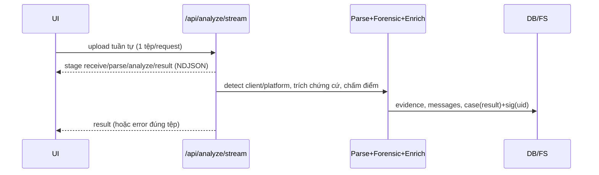

# Kế hoạch & trạng thái nâng cấp điều tra — MailSleuth Python

> **Trạng thái hiện tại:** các hạng mục nâng cấp chính đã được triển khai trên mã nguồn `mailsleuth_python/` (phân tích/streaming, báo cáo & chữ ký SHA-256, URL intel local, đồ thị chứng cứ, map nội bộ, tài khoản/phân quyền theo uid, Local AI, giao diện/tab mới). Tài liệu này thay thế kế hoạch M1–M7 cũ và phản ánh kiến trúc/luồng thực tế hiện có.

---

## 1. Phạm vi & nguyên tắc

- Chỉ tác động `mailsleuth_python/` (bản Node gốc giữ nguyên, dữ liệu tách biệt qua `DATA_DIR`).
- **Offline-safe mặc định**: không bản đồ/AI ngoài; DNS thật tùy chọn (`LIVE_DNS`).
- **Không lưu bí mật nhạy cảm**: CCCD không lưu, khóa/verifier admin tạo offline; key dịch vụ per-user trong `kv`, không echo/log.
- Mọi thay đổi quan trọng đi kèm cơ chế kiểm chứng (chữ ký báo cáo, CSRF/RBAC, test/smoke khi phù hợp).

---

## 2. Kiến trúc hiện tại (tổng quan)

```mermaid
flowchart TB
  subgraph UI[Frontend SPA]
    A[Analysis - streaming 3 dòng + biên độ + %\nPause/Stop/Cancel]
    B[Results - Overview/Messages/URLs/Graph\nReport/Verify/Export-Import]
    C[Guide/History/DNS/IP-Geo/Local AI/Admin/Logs]
  end
  subgraph API[FastAPI app/main.py]
    S[Session + CSRF + RBAC\nownership: cases.uid]
    E[/analyze/stream (NDJSON)\n/analyze]
    R[report/verify, case, urls, graph, map]
    AD[admin, settings/llm]
  end
  subgraph Core[app/* modules]
    P[parsers,bodies] --> F[headers,authcheck,routing,urls,attachments,ioc]
    F --> U[urlintel local] --> REP[report: SHA-256 + seal]
    F --> G[graph/mapgen]
    L[llm local-only]
  end
  subgraph Data[DATA_DIR]
    D[(SQLite: users,cases,audit,kv,sessions,url_imports,...)]
    FS[evidence, messages, quarantine, uploads/tmp]
  end
  UI <--> API <--> Core <--> Data
  L -. optional .-> Core
```

### Thành phần chính
| Nhóm | Mô-đun/tệp | Vai trò |
|---|---|---|
| API & điều phối | `app/main.py` | Endpoint, streaming, authz/CSRF, hợp nhất kết quả, lưu case |
| Lưu trữ | `app/db.py` | SQLite WAL, migration (uid/phone/admin_kdf/sig/platform/url_imports...) |
| Tài khoản | `app/auth.py`, `tools/admin_keygen.py` | bcrypt user, recovery key, uid/SĐT, PBKDF2 admin verifier, rename token |
| Phân tích | `app/parsers.py`, `bodies.py`, `headers.py`, `authcheck.py`, `routing.py`, `urls.py`, `attachments.py`, `ioc.py` | Parse/nhận diện, header/auth/routing, URL/đính kèm/IOC, lưu body an toàn |
| Bổ sung | `app/enrichment.py`, `dns_real.py`, `mapgen.py`, `graph.py`, `urlintel.py`, `llm.py` | GeoIP/DNS local, map lược đồ, đồ thị chứng cứ, URL import/re-analysis local, Local AI |
| Báo cáo | `app/report.py` | HTML/PDF/CSV/JSON, `case_signature` SHA-256, seal góc dưới phải, verify, CSP |
| Giao diện | `public/index.html`, `app.js`, `app.css` | 9 tab, streaming UI, dark/i18n, export/import, admin |

---

## 3. Luồng nghiệp vụ & dữ liệu

### 3.1 Luồng phân tích


### 3.2 Luồng dữ liệu logic: vụ việc → thư → thực thể → liên kết
```mermaid
flowchart LR
  C[Case/Vụ việc\n(uid sở hữu, sig, platform, verdict/score)] --> M[Messages\n(header/body, client, auth, IP/URL/att refs)]
  M --> E[Entities\nactor, domain, ip, url, attachment/hash]
  E --> L[Links\nSENT, USES_DOMAIN, ORIGIN_IP,\nCONTAINS_URL, HAS_ATTACHMENT]
  L --> V[Graph SVG/JSON\nchỉ từ chứng cứ]
```
- Case gắn `uid` bất biến; `result.graph`/endpoint graph biểu diễn entities/links suy ra từ chứng cứ (không suy diễn danh tính).

### 3.3 Báo cáo, URL import, bản đồ, AI
- **Báo cáo:** `case_signature(row,result)` → SHA-256; seal hiển thị góc dưới phải; `GET /api/report/{id}/verify` tái tính đối chiếu. Ngôn ngữ `en/vi` cho HTML/PDF/CSV.
- **URL intel:** export theo target/nguồn; import CSV/JSON/XML/TXT → parse + rule local → merge verdict/risk/reasons → lưu `urlImports` → cập nhật case & **re-sign**.
- **Bản đồ:** `mapgen.py` vẽ schematic nội bộ từ tọa độ GeoIP (không tile/không dịch vụ ngoài).
- **Local AI:** `llm.py` + `/api/settings/llm`, chỉ localhost/private (`LLM_ALLOW_REMOTE=0`), redact, không hạ verdict rule.

---

## 4. Trạng thái hạng mục đã triển khai

| Hạng mục | Trạng thái | Ghi chú triển khai |
|---|---:|---|
| Phân tích EML/MSG/MBOX/Maildir/TXT, nhận diện client/nền tảng | Hoàn thành | `parsers.py`, `main.py`; `PST/OST` trích xuất ngoài rồi nạp |
| Streaming NDJSON, tiến độ thực, Pause/Stop/Cancel, dừng đúng lỗi | Hoàn thành | `/api/analyze/stream`, UI 3 dòng + biên độ + % |
| Header/Auth(SPF/DKIM/DMARC)/Routing/URL/Attachment/IOC | Hoàn thành | `headers.py`, `authcheck.py`, `routing.py`, `urls.py`, `attachments.py`, `ioc.py` |
| Báo cáo HTML/PDF/CSV/JSON đa ngôn ngữ + mộc/chữ ký SHA-256 + verify | Hoàn thành | `report.py`, endpoint report/verify, CSP/no-store |
| Thống kê IP/DNS/SPF/DMARC/routing/URL theo target, trích chứng cứ | Hoàn thành | Tổng hợp trong `result` và report/tabs |
| Đồ thị thực thể/liên kết từ chứng cứ | Hoàn thành | `graph.py`, `/api/case/{id}/graph(.svg)` |
| Bản đồ lược đồ nội bộ (thay map ngoài) | Hoàn thành | `mapgen.py`, `/api/map` local |
| URL export/import & tái phân tích local, merge, re-sign | Hoàn thành | `urlintel.py`, `/api/urls/import`, `/api/case/{id}/urls(.csv)` |
| Tài khoản: uid hex32, SĐT, Key ID khôi phục, đổi tên token một lần | Hoàn thành | `auth.py`, `db.py`, profile/rename APIs |
| Admin: PBKDF2-HMAC-SHA256 (password+CCCD salt), keygen offline, không lưu CCCD | Hoàn thành | `tools/admin_keygen.py`, `admin_kdf`/verifier |
| Phân quyền & chống leo thang ngang/dọc, CSRF, tab Admin chỉ admin | Hoàn thành | RBAC, `cases.uid` ownership, guard self-demote/disable |
| Local AI (endpoint local, chặn cloud) | Hoàn thành | `llm.py`, `/api/settings/llm`, `LLM_ALLOW_REMOTE=0` |
| UI: 9 tab, Results/Messages/URLs/Graph, Guide, dark, cảnh báo viền, Win/Linux, export/import picker | Hoàn thành | `public/index.html`, `app.js`, `app.css` |
| Quét nội dung độc hại offline/local (heuristic + YARA/ClamAV/sandbox, không Internet) | Hoàn thành | `threatscan.py`, `attachments.py`, `rules/yara/default.yar`, `.env.example` (`THREATSCAN_*`/`YARA_*`/`CLAMSCAN_CLI`/`SANDBOX_URL`) |
| An toàn bổ sung | Hoàn thành | CSV formula-safe, CSP/nosniff/no-referrer/no-store, body sanitize+sandbox |

---

## 5. Kiến trúc dữ liệu lưu trữ (SQLite & FS)

- **Bảng chính:** `users` (uid, phone, role, recovery hash, admin_kdf, rename_token...), `cases` (id, uid, sig, platform, lang, result JSON), `audit`, `kv`, `sessions`, `session_signatures`, `url_imports`.
- **Tệp:** `evidence/<case>.bin` (gốc, read-only), `messages/<case>/` (header/body trích), `quarantine/` (mẫu nguy hiểm cô lập), `uploads/tmp/reports`.

---

## 6. Hạng mục còn mở/đề xuất tiếp theo

- **Kiểm thử UI tự động E2E** ổn định hơn cho streaming/picker/graph trên môi trường CI/headless.
- **Xử lý nội dung độc hại (đã triển khai, 2 hướng kết hợp, offline-safe):** lớp mặc định heuristic Python + `yara-python`/rule cục bộ (`rules/yara/*.yar`) khi có; lớp tăng cường tùy chọn qua adapter local có timeout/giới hạn dung lượng (YARA CLI, ClamAV/clamdscan, sandbox HTTP chỉ localhost/private, **không gửi dữ liệu ra Internet**). Kết quả chuẩn hóa vào findings/IOC/verdict; tệp nguy hiểm được cách ly/quarantine. Có thể tiếp tục mở rộng bộ rule/heuristic và kiểm thử E2E theo nhu cầu.
- **Đối chiếu “mẫu báo cáo chuẩn” cụ thể** của đơn vị (nếu có template bắt buộc) để tinh chỉnh bố cục/trường.
- **Rà soát phụ thuộc định kỳ** (pip-audit/pinning) và hardening triển khai (HTTPS, reverse proxy, sao lưu/vệ sinh).

---

## 7. Ghi chú thay thế so với kế hoạch cũ (M1–M7)

- Mô-đun forensic cốt lõi (header/auth/routing/URL/attachment/IOC) vẫn là nền tảng nhưng đã được tích hợp sâu vào luồng streaming, báo cáo có chữ ký, URL intel và đồ thị.
- `PST/OST` không parse nội bộ; **map ngoài (MapGlot/OSM tiles)** đã thay bằng **map lược đồ nội bộ**; AI chỉ **local**.
- Quản trị/tài khoản chuyển sang mô hình uid bất biến + PBKDF2 verifier (offline keygen, không lưu CCCD), tăng cường phân quyền/chống leo thang và tab Administration.

*Tài liệu đồng bộ với mã nguồn tại thời điểm cập nhật; xem thêm `README.md` và `HUONG_DAN_SETUP_PYTHON.md`.*
