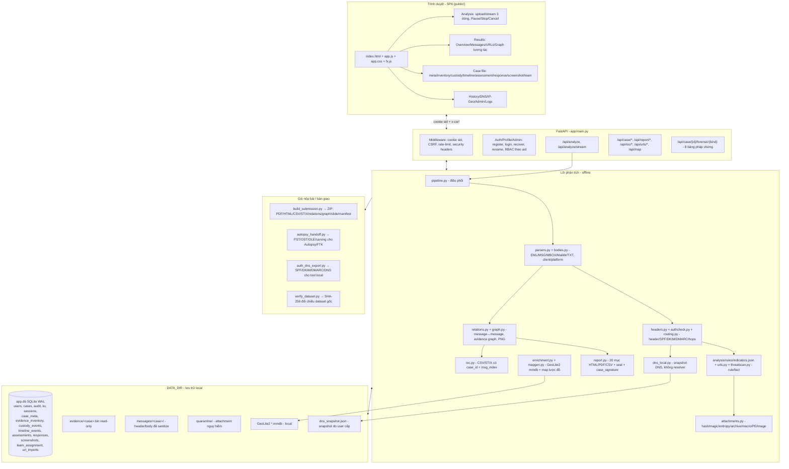
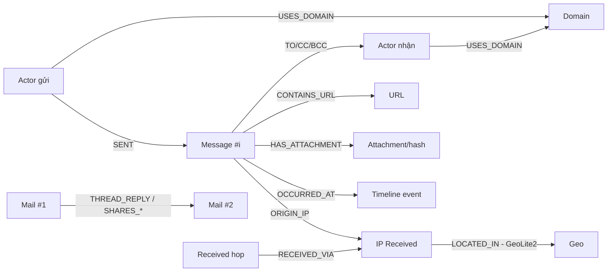
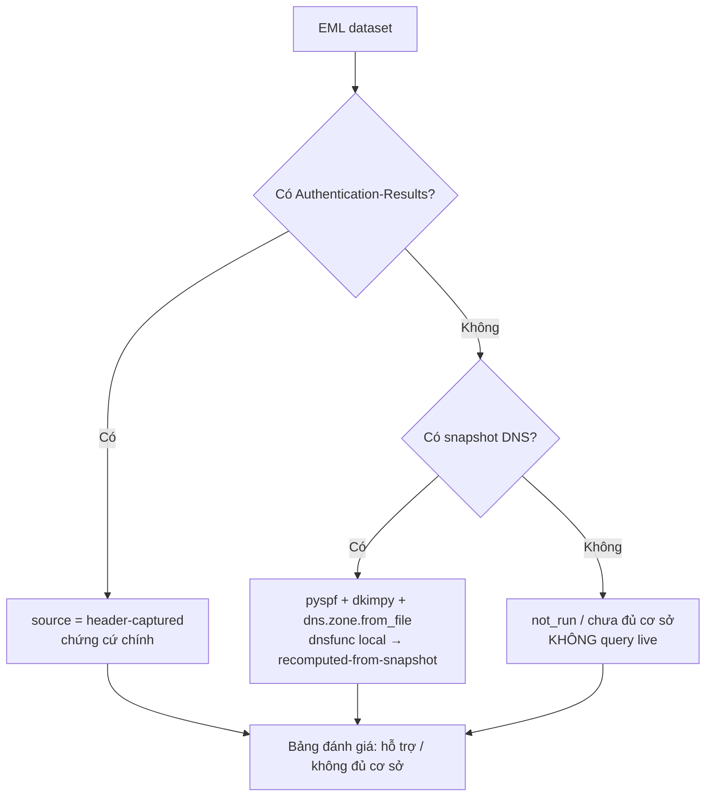
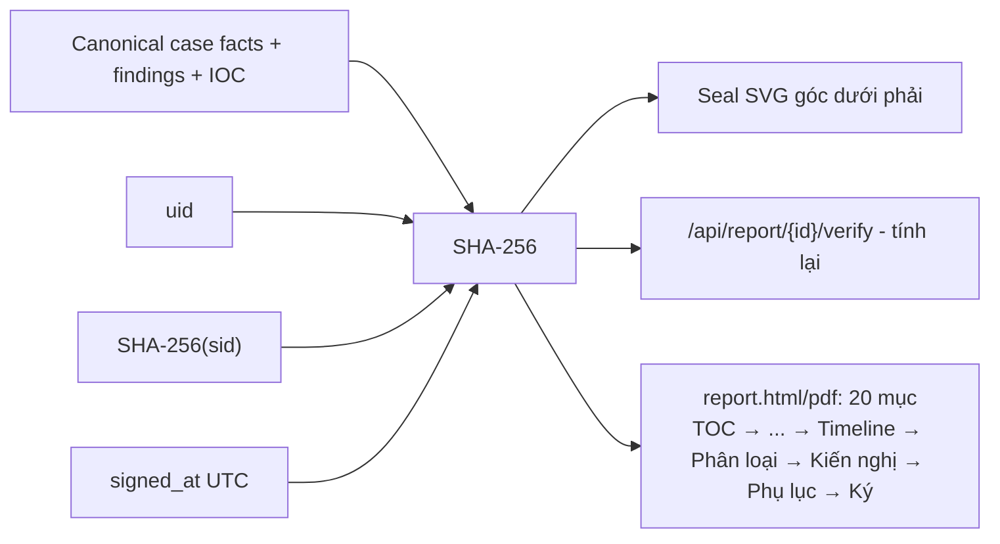
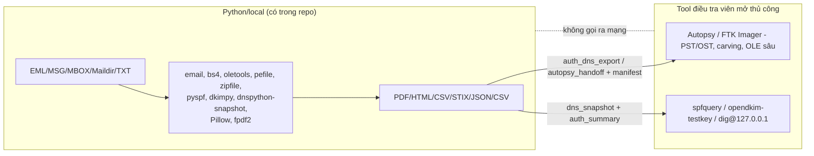

# KIẾN TRÚC HỆ THỐNG — MailSleuth Python (Forensic Offline 100%)

Tài liệu này giải thích **cấu trúc, luồng dữ liệu và lý do thiết kế** của codebase sau khi hoàn thành kế hoạch `TIEN_DO_BUILD.md`. Mọi sơ đồ dùng Mermaid, đọc được trên GitHub/VS Code. Không có thành phần nào gọi mạng.

---

## 1. Nguyên tắc kiến trúc

1. **Offline tuyệt đối**: không `requests`, không API/reputation, không MxToolbox/VirusTotal, không SIEM, không DNS resolver live, không AI/ML đổi verdict.
2. **Chứng cứ là gốc**: mọi finding, cạnh quan hệ, timeline event đều có field nguồn + `evidence`.
3. **Rule driven**: indicator nằm trong `analysis/rules/indicators.json`, có unit test; không chấm điểm cảm tính/theo brand.
4. **Điều phối mỏng**: `app/pipeline.py` chỉ nạp file → gọi core → xuất; logic nằm ở module chuyên biệt.
5. **Toàn vẹn theo phiên**: `case_signature = SHA-256(canonical facts + uid + SHA-256(sid) + signed_at)`; không lộ raw session id.
6. **Sở hữu bất biến**: `cases.uid` không đổi khi rename; mọi ghi kiểm tra RBAC/CSRF.

---

## 2. Sơ đồ thành phần tổng thể



**Giải thích lớp**
- **Client**: chỉ là giao diện; không tự quyết verdict, không gọi API ngoài (kể cả local AI đã gỡ).
- **API**: xác thực/CSRF/RBAC, điều phối request, trả dữ liệu; ownership luôn theo `uid`.
- **Core**: module Python chuyên biệt. `pipeline.py` không chứa rule; `analysis/rules/` là nguồn indicator duy nhất.
- **Store**: SQLite + file; evidence gốc read-only, mọi thay đổi dẫn tới re-sign.
- **Export**: đóng gói cho điều tra viên/tool khác, vẫn offline, kèm `manifest.sha256`.

---

## 3. Luồng phân tích một lô email (sequence)

```mermaid
sequenceDiagram
  autonumber
  participant U as Analyst
  participant UI as SPA
  participant API as FastAPI
  participant P as pipeline.py
  participant C as Core libs
  participant DB as SQLite + FS

  U->>UI: Chọn tệp/thư mục, khai mục tiêu/phạm vi (tab Case file)
  UI->>API: POST /api/case/{id}/forensic/meta (CSRF)
  UI->>API: POST /api/analyze/stream (mỗi file 1 request)
  API->>P: _analyze_one(name, bytes, user, uid)
  P->>C: parse → header → auth → URL → attachment → GeoIP → IOC
  C-->>P: findings[] có source_field + evidence
  P->>C: relations.build() → timeline events
  P->>DB: lưu evidence read-only, messages/, case JSON
  P->>DB: case_signature (uid + SHA-256(sid) + signed_at)
  API-->>UI: NDJSON stage/result (dừng đúng file nếu lỗi)
  UI->>UI: tự chuyển Results; vẽ Graph + danh sách quan hệ
  U->>UI: Xem/điền custody, assessment, response, screenshot, team
  UI->>API: POST /api/case/{id}/forensic/{kind}
  API->>DB: insert + _resign_case() (re-sign SHA-256)
  U->>API: GET /api/report/{id}.pdf|html|csv, /verify
```

**Điểm chú ý**
- Streaming giữ nguyên hành vi cũ: `stage` → `result`; Pause/Stop/Cancel không thay đổi.
- Mỗi lần ghi vào 8 bảng pháp chứng đều gọi `_resign_case()` → chữ ký luôn phản ánh dữ liệu mới nhất.
- Lỗi ở một file không làm mất kết quả các file đã xong.

---

## 4. Mô hình dữ liệu (#)

```mermaid
erDiagram
  USERS ||--o{ CASES : "uid sở hữu"
  CASES ||--o| CASE_META : "objective/scope/source"
  CASES ||--o{ EVIDENCE_INVENTORY : "msg_index + sha256"
  CASES ||--o{ CUSTODY_EVENTS : "actor/transfer/hash"
  CASES ||--o{ TIMELINE_EVENTS : "ts + confidence"
  CASES ||--o{ ASSESSMENTS : "observed/inference/unverified"
  CASES ||--o{ RESPONSE_ACTIONS : "action/rationale"
  CASES ||--o{ SCREENSHOTS : "tool/step/caption"
  CASES ||--o{ TEAM_ASSIGNMENT : "member/role/tasks"
  CASES ||--o{ URL_IMPORTS : "re-analysis local"
  CASES {
    text id PK
    text uid FK
    text sha256
    text sig
    text session_fingerprint
    text signed_at
    text result JSON
  }
  EVIDENCE_INVENTORY {
    int id PK
    int msg_index
    text role
    text name
    text sha256
    text source_field
  }
  TIMELINE_EVENTS {
    int id PK
    text ts
    int msg_index
    text source_field
    text confidence
  }
  ASSESSMENTS {
    int id PK
    text kind
    text claim
    text evidence_refs
    text limitation
  }
```

**Quy tắc**
- Không xóa `cases.user` khi đổi tên (lịch sử/chữ ký giữ nguyên).
- `uid` là khóa sở hữu; admin xem tất cả nhưng vẫn ghi audit.
- Export có `case_id + msg_index`, sort `(msg_index, type, value)` → không trộn giữa các thư.

---

## 5. Quan hệ chứng cứ & graph giao diện



- Cạnh liền = **quan sát** được từ field; cạnh đứt = **suy luận** (`TIME_NEAR`) — UI ghi rõ `confidence`.
- Graph có layout deterministic (cùng input → cùng ảnh), `graph.to_png()` để nhúng PDF; HTML dùng SVG.
- UI lọc theo loại cạnh, click vào cạnh hiện `evidence`; link tải `relations.csv`.

---

## 6. SPF/DKIM/DMARC & DNS lịch sử



Thư viện: `spf` (pyspf), `dkim` (dkimpy), `dns` (dnspython, **chỉ** `dns.zone`), `idna`, `email` (stdlib), `ipaddress`, `urllib.parse`. `tools/auth_dns_export.py` đóng gói raw record + snapshot + `manifest.sha256` cho tool local khác.

---

## 7. Báo cáo & chữ ký



Chữ ký là **fingerprint toàn vẹn có tính tái lập**, không phải chữ ký PKI; verify endpoint cho phép đối chiếu. `session_fingerprint` là hash của sid → không lộ session token trong file báo cáo.

---

## 8. Ranh giới & bàn giao ngoài



---

## 9. Bản đồ tập tin quan trọng

| Tập tin | Vai trò |
|---|---|
| `app/main.py` | API, auth/CSRF/RBAC, streaming, endpoints forensic/report |
| `app/pipeline.py` | Điều phối nạp dataset → lõi → xuất báo cáo |
| `app/parsers.py`, `app/bodies.py` | Đọc định dạng, client/platform, sanitize body |
| `app/headers.py`, `authcheck.py`, `routing.py` | Header, SPF/DKIM/DMARC, Received hops |
| `analysis/rules/indicators.json`, `app/urls.py`, `app/threatscan.py` | Rule/fact, URL & attachment an toàn |
| `app/attachments.py` | Hash/magic/entropy/archive/macro/PE/image |
| `app/dns_local.py` | DNS snapshot, không live |
| `app/enrichment.py`, `mapgen.py` | GeoLite2 + bản đồ lược đồ |
| `app/relations.py`, `graph.py` | Quan hệ mail↔mail, graph SVG/PNG |
| `app/report.py`, `ioc.py` | Báo cáo 20 mục, seal, IOC CSV/STIX có index |
| `app/db.py` | Schema + migration, ownership `uid` |
| `tools/verify_dataset.py` | Kiểm SHA-256 dataset gốc |
| `tools/dns_snapshot.py`, `auth_dns_export.py` | Snapshot DNS + gói bàn giao xác thực |
| `tools/autopsy_handoff.py`, `build_submission.py` | Gói Autopsy + ZIP nộp bài |
| `public/index.html`, `app.js` | 9 tab + tab Case file, dashboard Findings/Relations |
| `TIEN_DO_BUILD.md` | Tiêu chuẩn build/test + trạng thái phase |
| `BAO_CAO_HOAN_THANH_DIGITAL_FORENSICS.md` | Đối chiếu yêu cầu + 31 test + giới hạn |

---

## 10. Giới hạn phải ghi khi báo cáo
- GeoLite2 cho vị trí gần đúng; không phản ánh quá khứ nếu dùng DB hiện tại.
- Thiếu Received/Authentication-Results → ghi `not_run`, không suy đoán IP/danh tính.
- DKIM có thể không verify nếu body/MIME thay đổi sau khi nhận.
- Autopsy/FTK là bước ngoài; hệ thống chỉ đóng gói + hướng dẫn.
- `TIME_NEAR` và map mũi tên là lớp suy luận/phụ, không dùng để kết luận.

> Mọi thay đổi kiến trúc phải cập nhật đồng thời tài liệu này, `HUONG_DAN_SETUP_PYTHON.md` và `TIEN_DO_BUILD.md`.

## 11. Global Relations (bổ sung)
`app/global_graph.py` + `/api/graph/global` + tab **Relations** thay cho DNS/IP-Geo: index toàn bộ case → cạnh `SENT/TO/ORIGIN_IP/...` có evidence → UI lọc/index/SVG/CSV. Xem `BAO_CAO_HOAN_THANH_DIGITAL_FORENSICS.md` mục 13.

---

## 12. Kiến trúc hoàn chỉnh sau fix cuối (tham chiếu chính)

### 12.1 Sơ đồ tổng thể (cập nhật)

```mermaid
flowchart TB
  subgraph UI["SPA - public/index.html + app.js + app.css + fx.js"]
    TABS["8 tab: Analysis / Results / Guide / History / Relations / Case file / Admin / Logs"]
    DASH["Dashboard: Cases / Messages / Malicious / Suspicious / Clean / Findings / Relations"]
    RES["Results: Overview / Messages / URLs / Graph / Timeline + Total analysed"]
    REL["Relations: index 30.000 thư + Message-ID/From/To + filter + SVG + CSV"]
    CASE["Case file: 8 sections + form Assessment/Response"]
  end

  subgraph API["FastAPI app/main.py"]
    SEC["Auth / CSRF / RBAC(uid) / rate limit stream 6000 + pace 60ms"]
    ANA["/api/analyze/stream + /api/analyze"]
    CASEAPI["/api/cases(limit 30000) + /api/cases/count + /api/case/* + /api/forensic/*"]
    REPORT["/api/report/{id} HTML/PDF/CSV + /verify"]
    GAPI["/api/graph/global + /api/graph/index"]
  end

  subgraph CORE["Lõi offline - analysis/ + app/"]
    PARSE["parsers/bodies: EML/MSG/MBOX/Maildir/TXT + client/platform"]
    RULES["analysis/rules/indicators.json + urls/threatscan: rule/fact có source_field"]
    AUTH["authcheck + dns_local(snapshot): SPF/DKIM/DMARC từ AR/snapshot"]
    EXT["attachments + oletools/pefile/bs4/zipfile: hash/magic/macro/archive"]
    RELMOD["relations + global_graph + graph + mapgen + timeline + ioc"]
    SIGN["report.py: 20 mục + seal SHA-256 + phụ lục hash thật"]
  end

  subgraph STORE["DATA_DIR"]
    DB[("SQLite: cases + 8 bảng pháp chứng + url_imports + sessions")]
    FS["evidence/ read-only, messages/, quarantine/, uploads/, reports/"]
    SNAP["dns_snapshot.json + GeoLite2 mmdb(local)"]
  end

  subgraph OUT["Xuất/bàn giao"]
    ZIP["build_submission.py → ZIP: report + ioc/STIX + relations + graph + slide + manifest"]
    HAND["auth_dns_export.py + autopsy_handoff.py + verify_dataset.py"]
  end

  UI <--> API
  API --> CORE
  CORE <--> STORE
  CORE --> OUT
  OUT --> UI
```



### 12.2 Các fix cuối đã áp dụng (đồng bộlocal + VM)
1. **Phụ lục export thật**: `build_submission` xuất file phụ trước → tính `sha256/size` → nhét `result.exports` → mới render report → phụ lục có hash thật.
2. **Chữ ký phủ đủ**: `case_signature` thêm `extra = timeline_events/assessments/responses/screenshots/team/exports`; mọi ghi pháp chứng qua API đều re-sign; verify khớp.
3. **Map snapshot**: `_report_parts` dùng `result.ipInfo[].geo` lưu lúc phân tích, không gọi `geo_lookup()` lại lúc xuất.
4. **Form pháp chứng**: tab Case file có 2 form thêm đánh giá (observed/inference/unverified) và kiến nghị ứng phó; lưu qua POST + re-sign.
5. **Stat đúng**: `relStat` dùng `actors_total` (3026), không phải top 60; History limit 30000, text đúng; favicon SVG local hết 404.
6. **Graph 30.000 case**: index qua SQLite JSON1 (nhanh ~6–10s), nhóm đủ Thư/Actor/Domain/IP/URL/Hash.

### 12.3 Trạng thái nghiệm thu
- HEAD `d2c5dd3` = `origin/main` trên local **và** VM; working tree sạch.
- 13/13 unit test PASS; `py_compile` + `node --check` OK; console browser 0 lỗi.
- `/api/health` 200 (`offline:true`); mọi endpoint báo cáo/xuất/graph 200.
- Dữ liệu: 15.029 case; Relations index 30.000; phân loại bad 48 / suspicious 14.971 / clean 10.

> File này là nguồn tham chiếu kiến trúc. Mọi thay đổi sau này phải cập nhật đồng thời `HUONG_DAN_SETUP_PYTHON.md`, `TIEN_DO_BUILD.md` và `BAO_CAO_HOAN_THANH_DIGITAL_FORENSICS.md`.
